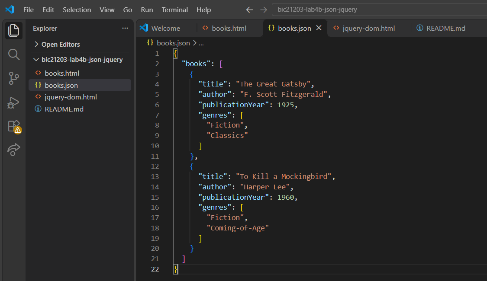
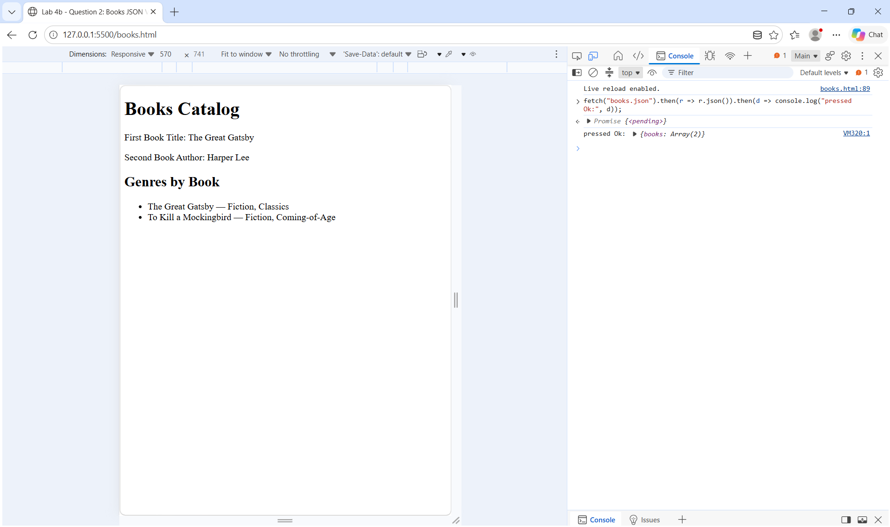
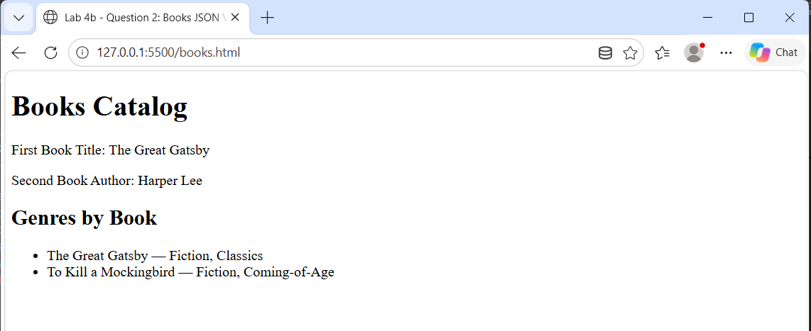
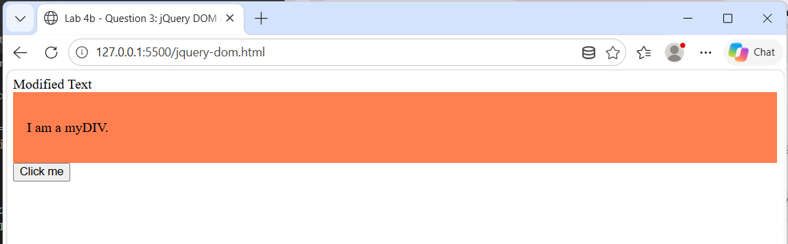

# BIC21203 - Lab #4b: Client-Side Scripting (JSON and jQuery)

**Student Name:** Malika Zainab  
**Matric No.:** A25005  
**Course:** BIC21203 Web Development (Session 2026/2027)

## Overview
This repository contains the files for Lab #4b covering JSON data structuring, asynchronous retrieval with `fetch()`, and DOM/event manipulation using jQuery 4.0.0.

## Files in This Repository
- `books.json` — Top-level `"books"` array with two book objects (`title`, `author`, `publicationYear`, and `genres`).
- `books.html` — Fetches `books.json` via a local server and displays the first book's title, second book's author, and grouped genres with error handling.
- `jquery-dom.html` — Uses jQuery 4.0.0 (`jquery-4.0.0.min.js`) to update `#myElement` text, apply `.myStyle` to `#myDIV`, and handle `#myButton` clicks.

## Setup & Running Instructions
1. Clone or download this repository to your computer and open the folder in **Visual Studio Code**.
2. Start **Live Server** in VS Code (do **not** open `books.html` directly via `file://`, as browsers block `fetch()` requests to local JSON files under `file://`).
3. Open `books.html` through Live Server (`http://127.0.0.1:5500/books.html`) to verify the book details and grouped genres render properly.
4. Open `jquery-dom.html` through Live Server (`http://127.0.0.1:5500/jquery-dom.html`) to verify the modified text, coral box styling, and click alert (`"Button clicked!"`).

## Screenshots

### Question 1 (`books.json`)

### Question 2 (`books.html` via Live Server)

### Question 3 (`jquery-dom.html`)

